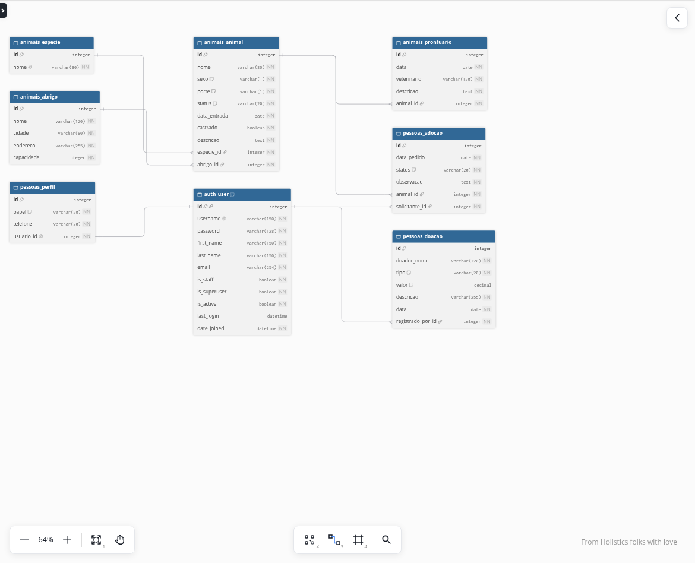

# Trabalho Prático 1 - Acolhe: Sistema de Gestão de ONG Animal

<p align="center">
  <a href="#">
    
  </a>
  <a href="#">
    
  </a>
  <a href="#">
    
  </a>
</p>

## Índice

* [Introdução](#introdução)
* [Integrantes do Grupo](#integrantes-do-grupo)
* [Recursos Utilizados](#recursos-utilizados)
* [Funcionalidades](#funcionalidades)
* [Modelagem do Banco de Dados](#modelagem-do-banco-de-dados)
* [Instalação e Execução](#instalação-e-execução)
* [Estrutura do Projeto](#estrutura-do-projeto)
* [Referências e Materiais de Apoio](#referências-e-materiais-de-apoio)

## Introdução

<a href="#índice"></a>

O Acolhe é um sistema para gestão de uma ONG de proteção animal, feito com o framework Python Django. Ele organiza animais resgatados, abrigos, adoções, prontuário veterinário, doações e voluntários.

Este projeto foi desenvolvido na disciplina GAC116 - Programação Web da Universidade Federal de Lavras (UFLA). O Django cuida do banco de dados, da autenticação e da área administrativa. A área dos usuários é feita em Vue.js e conversa com o Django por meio de uma API em JSON.

## Integrantes do Grupo

<a href="#índice"></a>

* Felipe Geraldo
* Henrique
* Felipe Crisostomo

## Recursos Utilizados

<a href="#índice"></a>

### Linguagens

* Python - Linguagem de programação do backend
  * [Link do site Python](https://www.python.org/)
* JavaScript - Linguagem do frontend
  * [Link do curso da W3Schools](https://www.w3schools.com/js/default.asp)
* SQL - Linguagem para consultas no banco de dados
  * [Link do curso da W3Schools](https://www.w3schools.com/sql/default.asp)

### Frameworks

* Django - Framework web
  * [Link do site do Django](https://www.djangoproject.com/)
* Vue.js - Framework JavaScript para a interface
  * [Link do site do Vue.js](https://vuejs.org/)
* Bootstrap - Framework CSS
  * [Link do site do Bootstrap](https://getbootstrap.com/)

### Bibliotecas

* Jazzmin - Biblioteca Python para Interface Administrativa do Django
  * [Link do django-jazzmin](https://django-jazzmin.readthedocs.io/)
* Vue Router - Biblioteca para as rotas do Vue.js
  * [Link do site do Vue Router](https://router.vuejs.org/)
* Vite - Ferramenta para executar e compilar o Vue.js
  * [Link do site do Vite](https://vite.dev/)

### Ferramentas

* Visual Studio Code - Ambiente de Desenvolvimento Integrado
  * [Link site Visual Studio](https://code.visualstudio.com/)
* Git - Sistema de controle de versão
  * [Link site do Git](https://git-scm.com/)
* Pip - Gerenciador de pacotes do Python
  * [Link site do Pip](https://pypi.org/project/pip/)
* Venv - Ambiente virtual do Python
  * [Link site do Venv](https://docs.python.org/pt-br/3/library/venv.html)
* SQLite - Banco de dados
  * [Link site do SQLite](https://www.sqlite.org/)
* dbdiagram.io - Desenho da modelagem do banco
  * [Link site do dbdiagram.io](https://dbdiagram.io/)

## Funcionalidades

<a href="#índice"></a>

* Cadastro, login e logout.
* Três perfis: adotante, voluntário e gestor.
* Adotante: vê os animais disponíveis, pede adoção e acompanha os próprios pedidos.
* Voluntário: cadastra e edita animais, registra prontuário e doações, consulta adoções.
* Gestor: tudo o que o voluntário faz, além de aprovar ou recusar adoções, gerenciar abrigos e cadastrar voluntários.
* Área administrativa (Jazzmin) com busca, filtros e histórico por data.
* Tema claro e tema escuro na interface.

Regras de negócio:

* Aprovar uma adoção marca o animal como adotado e recusa os outros pedidos do mesmo animal. Desfazer a aprovação libera o animal. Isso vale na interface e no admin.
* Um abrigo lotado não aceita novos animais. Animais adotados não ocupam vaga.
* A senha segue os validadores do Django (tamanho mínimo, senhas comuns e só números).

## Modelagem do Banco de Dados

<a href="#índice"></a>

O desenho foi feito no [dbdiagram.io](https://dbdiagram.io) a partir do arquivo `docs/modelagem.dbml`. Os nomes são os das tabelas no SQLite.



```text
Especie 1---N Animal N---1 Abrigo
Animal  1---N Prontuario
Animal  1---N Adocao N---1 User
User    1---1 Perfil
User    1---N Doacao
```

As espécies novas são cadastradas no admin.

## Instalação e Execução

<a href="#índice"></a>

### Clonar o Repositório

```bash
git clone <endereço-do-repositório>
```

### Navegar até a Pasta do Projeto

```bash
cd acolhe/code
```

### Criar e Ativar o Ambiente Virtual

```bash
python3 -m venv venv
source venv/bin/activate
```

No Windows, ative com `venv\Scripts\activate`.

### Instalar as Dependências do Projeto

```bash
pip install -r requirements.txt
```

### Criar o Banco de Dados

```bash
python3 manage.py migrate
```

### Popular o Banco com Dados de Exemplo

```bash
python3 scripts-bd/popula_dados.py
```

Para apagar os dados de exemplo, execute:

```bash
python3 scripts-bd/deleta_dados.py
```

O script cria os usuários abaixo:

| Usuário    | Senha         | Papel                 |
|------------|---------------|-----------------------|
| admin      | admin123      | gestor (superusuário) |
| gestor     | gestor123     | gestor (superusuário) |
| voluntario | voluntario123 | voluntário            |
| adotante   | adotante123   | adotante              |

### Executar o Projeto

```bash
python3 manage.py runserver
```

Abra `http://127.0.0.1:8000/`. A área administrativa fica em `http://127.0.0.1:8000/admin/`. Entre com `admin` ou `gestor`.

Um superusuário criado com `python3 manage.py createsuperuser` também funciona e é tratado como gestor.

### Alterar a Interface Vue

O Vue já vem compilado em `code/static/spa`. Para alterar a interface e ver a mudança na hora, em outro terminal:

```bash
cd frontend
npm install
npm run dev
```

O Vite abre `http://127.0.0.1:5173` e encaminha a API para o Django. Depois de mudar o Vue, gere de novo os arquivos que o Django serve:

```bash
npm run build
```

## Estrutura do Projeto

<a href="#índice"></a>

```text
acolhe/
├── Changelog.md
├── LICENSE
├── README.md
├── code/
│   ├── manage.py
│   ├── requirements.txt
│   ├── gestao_ong/      # configurações, Jazzmin e página do Vue
│   ├── animais/         # espécies, abrigos, animais e prontuários
│   ├── pessoas/         # perfis, adoções, doações e voluntários
│   ├── scripts-bd/      # scripts para popular e apagar os dados
│   └── static/spa/      # Vue já compilado
├── docs/                # modelagem e imagens
└── frontend/            # código-fonte Vue
```

## Referências e Materiais de Apoio

<a href="#índice"></a>

Este trabalho foi baseado nos seguintes materiais:

* [Documentação oficial do Django](https://docs.djangoproject.com/pt-br/6.1/)
* [Curso de Django da W3Schools](https://www.w3schools.com/django/index.php)
* [Documentação do Vue.js](https://vuejs.org/guide/introduction.html)
* Aulas Django 02, 04 e 05 da disciplina GAC116 - Programação Web
