# Trabalho Prático - Acolhe: Sistema de Gestão de ONG Animal

<p align="center">
  <a href="#">
    
  </a>
  <a href="#">
    
  </a>
  <a href="#">
    
  </a>
</p>

## Índice

* [Introdução](#introdução)
* [Integrantes do Grupo](#integrantes-do-grupo)
* [Recursos Utilizados](#recursos-utilizados)
* [Funcionalidades](#funcionalidades)
* [Telas do Sistema](#telas-do-sistema)
* [Modelagem do Banco de Dados](#modelagem-do-banco-de-dados)
* [Instalação e Execução](#instalação-e-execução)
* [Estrutura do Projeto](#estrutura-do-projeto)
* [Referências e Materiais de Apoio](#referências-e-materiais-de-apoio)

## Introdução

<a href="#índice"></a>

O Acolhe é um sistema para gestão de uma ONG de proteção animal, feito com o framework Python Django. Ele organiza os animais resgatados, os abrigos, os pedidos de adoção, o prontuário veterinário, as doações e as pessoas que fazem parte da ONG.

Quem quer adotar se cadastra no site, procura um animal e envia o pedido de adoção. Os voluntários cadastram os animais, registram os atendimentos veterinários e as doações. O gestor aprova ou recusa as adoções e administra abrigos, espécies e a equipe.

Este projeto foi desenvolvido na disciplina GAC116 - Programação Web da Universidade Federal de Lavras (UFLA). As telas são templates do Django com o framework CSS Bootstrap. A área administrativa usa o Django Admin com o tema Jazzmin.

## Integrantes do Grupo

<a href="#índice"></a>

* Felipe Geraldo
* Henrique
* Felipe Crisostomo

## Recursos Utilizados

<a href="#índice"></a>

### Linguagens

* Python - Linguagem de programação principal
  * [Link do site Python](https://www.python.org/)
* HTML - Responsável pela estrutura das páginas
  * [Link do curso da W3Schools](https://www.w3schools.com/html/default.asp)
* CSS - Responsável pela apresentação das páginas
  * [Link do curso da W3Schools](https://www.w3schools.com/css/default.asp)
* JavaScript - Responsável pelo tema claro e escuro e pelos gráficos
  * [Link do curso da W3Schools](https://www.w3schools.com/js/default.asp)
* SQL - Linguagem para consultas no banco de dados
  * [Link do curso da W3Schools](https://www.w3schools.com/sql/default.asp)

### Frameworks

* Django - Framework web
  * [Link do site do Django](https://www.djangoproject.com/)
* Bootstrap - Framework CSS
  * [Link do site do Bootstrap](https://getbootstrap.com/)

### Bibliotecas

* Jazzmin - Biblioteca Python para Interface Administrativa do Django
  * [Link do django-jazzmin](https://django-jazzmin.readthedocs.io/)
* Pillow - Biblioteca Python para imagens (foto dos animais)
  * [Link do site do Pillow](https://python-pillow.github.io/)
* Chart.js - Biblioteca JavaScript para gráficos
  * [Link do site do Chart.js](https://www.chartjs.org/)
* FontAwesome - Biblioteca CSS para ícones
  * [Link do site do Fontawesome](https://fontawesome.com/)

### Ferramentas

* Visual Studio Code - Ambiente de Desenvolvimento Integrado
  * [Link site Visual Studio](https://code.visualstudio.com/)
* Git - Sistema de controle de versão
  * [Link site do Git](https://git-scm.com/)
* Github - Plataforma de hospedagem e colaboração em projetos de software
  * [Link site do Github](https://github.com/)
* Pip - Gerenciador de pacotes do Python
  * [Link site do Pip](https://pypi.org/project/pip/)
* Venv - Ambiente virtual do Python
  * [Link site do Venv](https://docs.python.org/pt-br/3/library/venv.html)
* SQLite - Banco de dados
  * [Link site do SQLite](https://www.sqlite.org/)
* dbdiagram.io - Desenho da modelagem do banco
  * [Link site do dbdiagram.io](https://dbdiagram.io/)

## Funcionalidades

<a href="#índice"></a>

* Página inicial pública com os números da ONG e os animais que chegaram por último.
* Cadastre-se, login e logout. Quem se cadastra pelo site entra como adotante.
* Meu perfil: alterar nome, e-mail, telefone e senha.
* Painel de acordo com o papel: o adotante vê os próprios pedidos e o gestor vê números, gráficos, pedidos pendentes e a ocupação dos abrigos.
* Animais: busca e filtros por espécie, porte, sexo, situação e abrigo, com foto, paginação e cadastro, edição e exclusão.
* Prontuário veterinário de cada animal.
* Pedido de adoção pelo adotante, com aprovação ou recusa pelo gestor.
* Doações em dinheiro, ração, medicamento ou outro, com o total arrecadado.
* Cadastro, edição e exclusão de abrigos e espécies.
* Pessoas: o gestor cria contas da equipe e muda o papel de cada usuário.
* Área administrativa com o tema Jazzmin, busca, filtros, histórico por data e ações de aprovar ou recusar adoções em lote.
* Interface responsiva, com tema claro e tema escuro.

### Perfis de Usuário

São três papéis, guardados na tabela `pessoas_perfil`. Todas as páginas, exceto a inicial, o login e o cadastro, exigem login.

| O que pode fazer | Adotante | Voluntário | Gestor |
|---|:---:|:---:|:---:|
| Ver os animais disponíveis e pedir adoção | Sim | - | - |
| Acompanhar e cancelar os próprios pedidos | Sim | - | - |
| Ver todos os animais e o prontuário | - | Sim | Sim |
| Cadastrar e editar animais e prontuários | - | Sim | Sim |
| Registrar e editar doações | - | Sim | Sim |
| Ver os abrigos e a lista de adoções | - | Sim | Sim |
| Aprovar ou recusar adoções | - | - | Sim |
| Excluir animais, prontuários e doações | - | - | Sim |
| Gerenciar abrigos, espécies e pessoas | - | - | Sim |
| Acessar a área administrativa (`/admin/`) | - | - | Sim |

O acesso à área administrativa vale para os usuários marcados como membros da equipe no admin, como `admin` e `gestor`. Um superusuário criado com `python3 manage.py createsuperuser` também é tratado como gestor.

### Regras de Negócio

* Aprovar uma adoção marca o animal como adotado e recusa os outros pedidos do mesmo animal. Desfazer a aprovação libera o animal. Isso vale nas telas e no admin.
* Só é possível pedir a adoção de um animal disponível, e o adotante não pode ter dois pedidos em análise para o mesmo animal.
* Um abrigo lotado não aceita novos animais, e a capacidade não pode ficar menor que o número de animais que já estão nele. Animais adotados não ocupam vaga.
* Não é possível excluir um animal com pedidos de adoção, nem um abrigo ou uma espécie com animais.
* Doação em dinheiro precisa ter valor, e o valor não pode ser negativo.
* A senha segue os validadores do Django (tamanho mínimo, senhas comuns, só números e parecida com o usuário).

## Telas do Sistema

<a href="#índice"></a>

Página inicial:

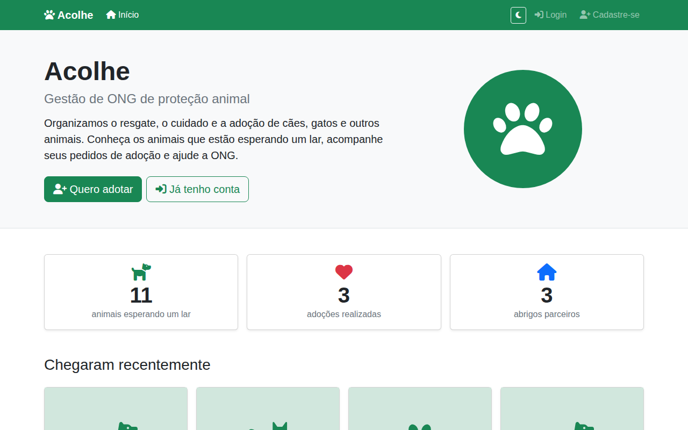

Cadastre-se:

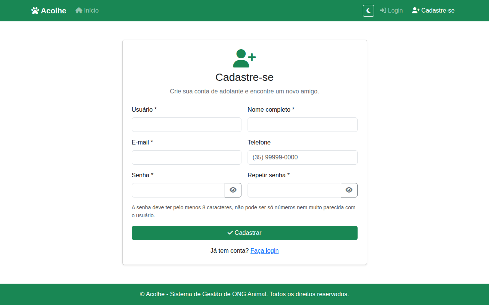

Painel do gestor:

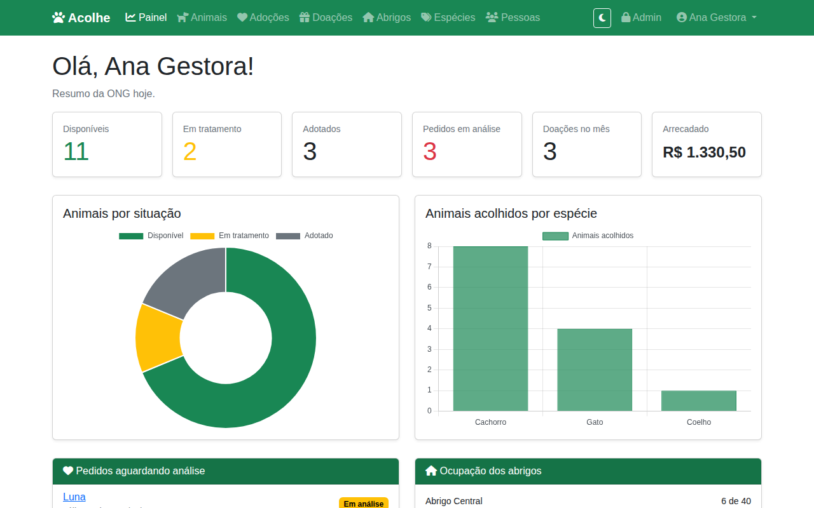

Animais, com busca e filtros:

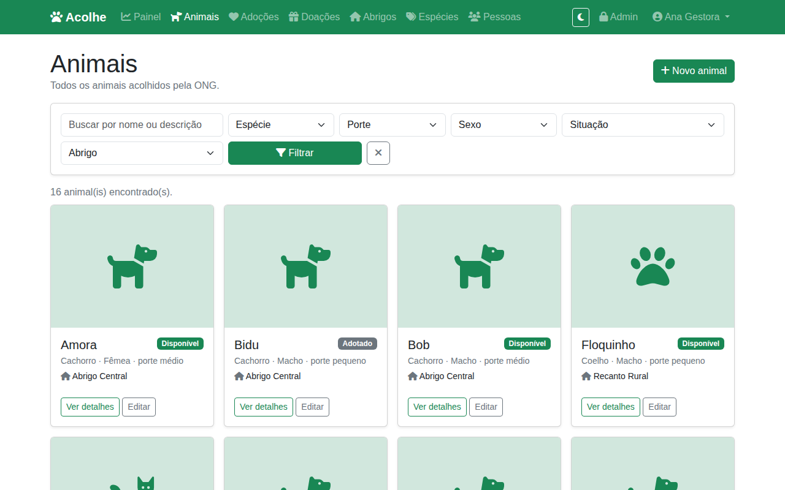

Detalhe do animal, com prontuário e pedidos de adoção:

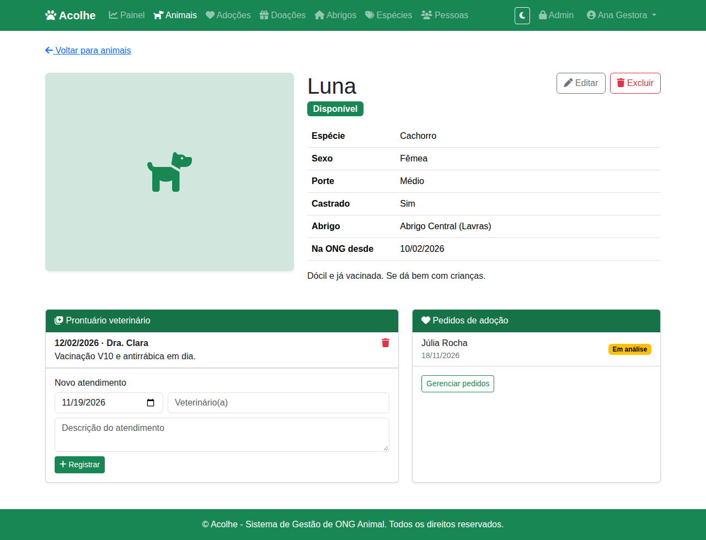

Adoções, com aprovação e recusa:

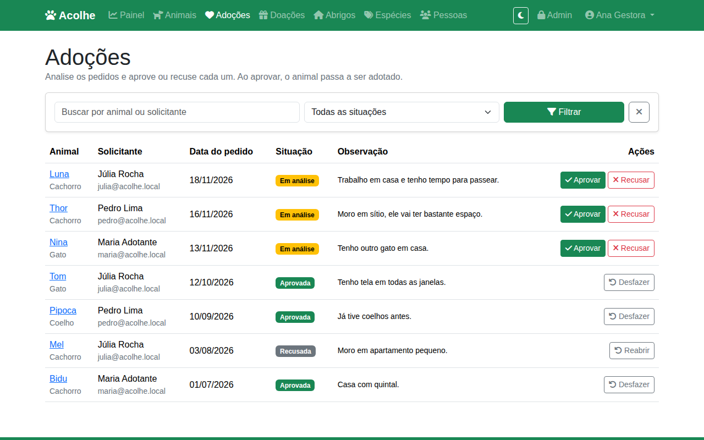

Doações:

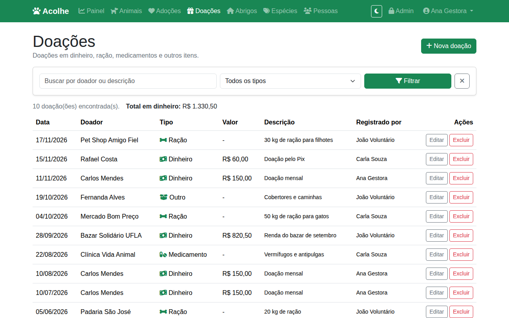

Abrigos:

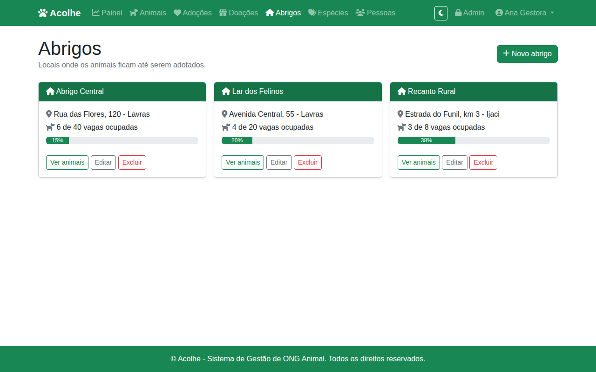

Tema escuro:

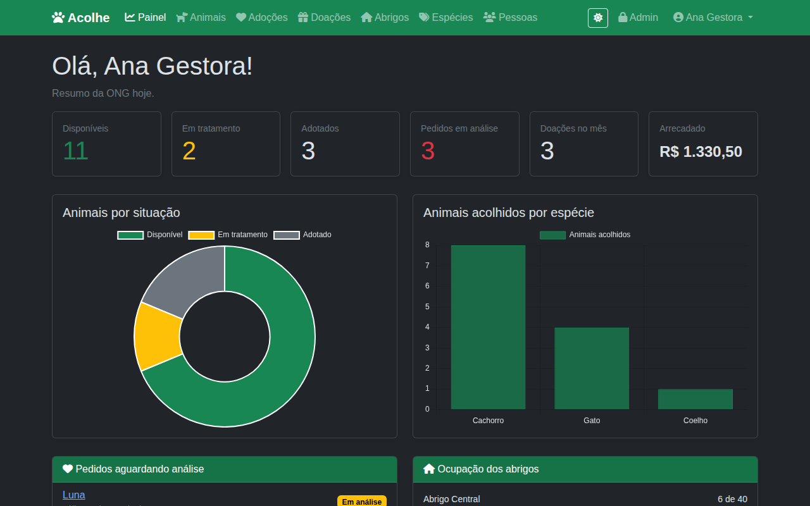

Celular, na conta de um adotante:

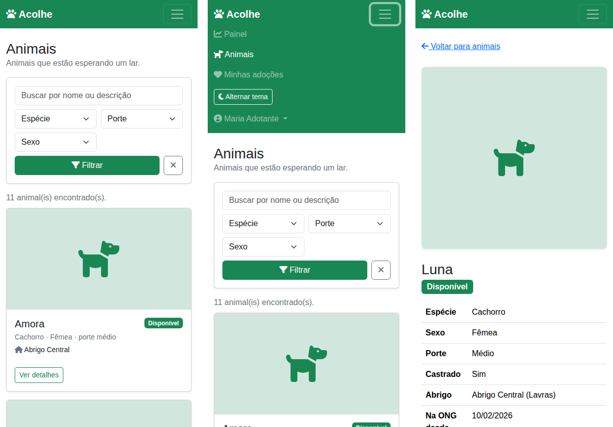

Área administrativa com Jazzmin:

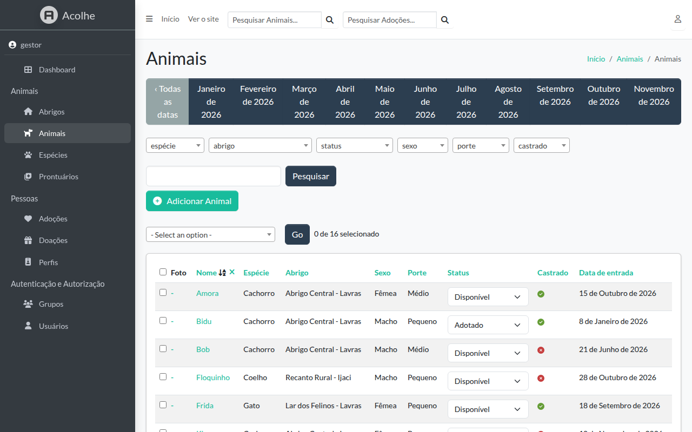

## Modelagem do Banco de Dados

<a href="#índice"></a>

O desenho foi feito no [dbdiagram.io](https://dbdiagram.io) a partir do arquivo `docs/modelagem.dbml`. Os nomes são os das tabelas no SQLite.

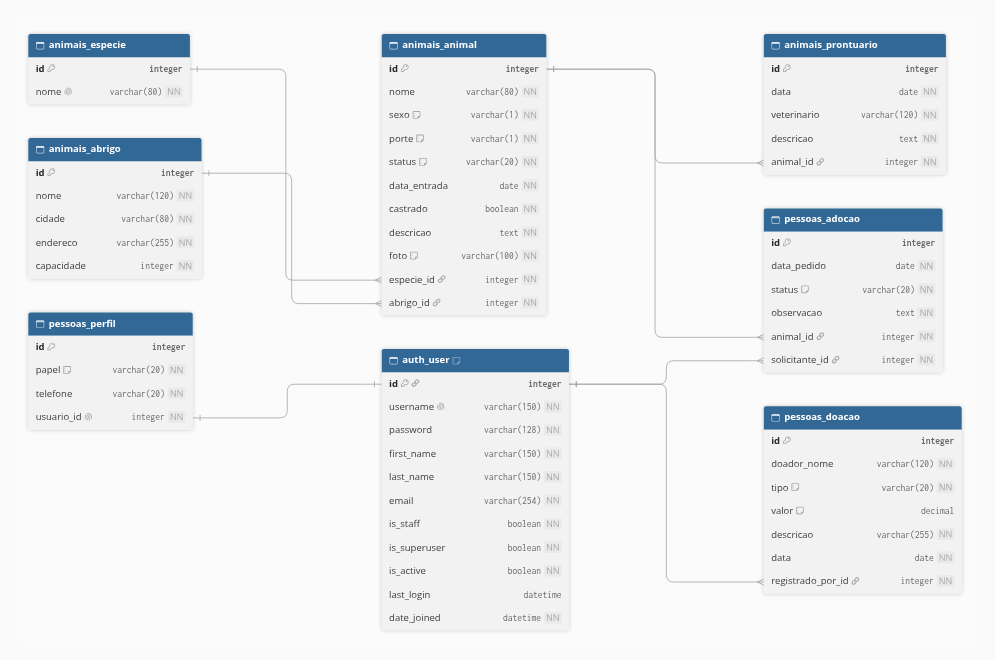

```text
Especie 1---N Animal N---1 Abrigo
Animal  1---N Prontuario
Animal  1---N Adocao N---1 User
User    1---1 Perfil
User    1---N Doacao
```

## Instalação e Execução

<a href="#índice"></a>

### Clonar o Repositório

```bash
git clone https://github.com/FelipeOliveira456/acolhe.git
```

### Navegar até a Pasta do Projeto

```bash
cd acolhe/code
```

### Criar e Ativar o Ambiente Virtual

```bash
python3 -m venv venv
source venv/bin/activate
```

No Windows, ative com `venv\Scripts\activate`.

### Instalar as Dependências do Projeto

```bash
pip install -r requirements.txt
```

### Criar o Banco de Dados

```bash
python3 manage.py migrate
```

### Popular o Banco com Dados de Exemplo

```bash
python3 scripts-bd/popula_dados.py
```

Para apagar os dados de exemplo, execute:

```bash
python3 scripts-bd/deleta_dados.py
```

O script cria os usuários abaixo:

| Usuário    | Senha         | Papel                 |
|------------|---------------|-----------------------|
| admin      | admin123      | gestor (superusuário) |
| gestor     | gestor123     | gestor (superusuário) |
| voluntario | voluntario123 | voluntário            |
| carla      | carla123      | voluntário            |
| adotante   | adotante123   | adotante              |
| pedro      | pedro123      | adotante              |
| julia      | julia123      | adotante              |

### Executar o Projeto

```bash
python3 manage.py runserver
```

Abra `http://127.0.0.1:8000/`. A área administrativa fica em `http://127.0.0.1:8000/admin/`. Entre com `admin` ou `gestor`.

As fotos enviadas no cadastro dos animais ficam na pasta `code/media/animais`.

## Estrutura do Projeto

<a href="#índice"></a>

```text
acolhe/
├── Changelog.md
├── LICENSE
├── README.md
├── code/
│   ├── manage.py
│   ├── requirements.txt
│   ├── gestao_ong/      # configurações, rotas, Jazzmin e página inicial
│   ├── usuarios/        # login, cadastro, logout, perfil, painel e permissões
│   ├── animais/         # espécies, abrigos, animais e prontuários
│   ├── pessoas/         # perfis, adoções, doações e pessoas
│   ├── templates/       # base.html e templates usados por todos os apps
│   ├── static/          # styles.css e script.js
│   └── scripts-bd/      # scripts para popular e apagar os dados
└── docs/                # modelagem e telas do sistema
```

## Referências e Materiais de Apoio

<a href="#índice"></a>

Este trabalho foi baseado nos seguintes materiais:

* [Documentação oficial do Django](https://docs.djangoproject.com/pt-br/6.1/)
* [Curso de Django da W3Schools](https://www.w3schools.com/django/index.php)
* [Documentação do Bootstrap](https://getbootstrap.com/docs/5.3/getting-started/introduction/)
* Aulas Django 02, 04 e 05 e aula de Bootstrap da disciplina GAC116 - Programação Web
